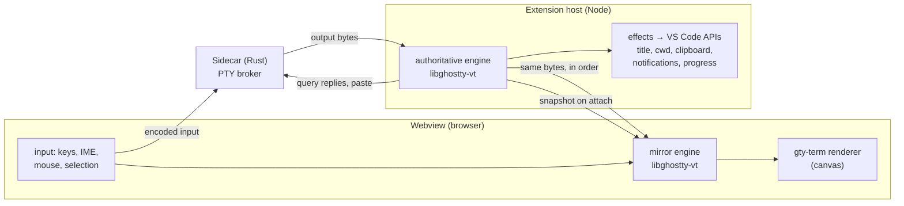

# code-gty on libghostty-vt: Implementation Plan

Nov 24, 2026

This plan replaces ghostty-web with code-gty's own terminal library built directly on libghostty-vt 1.0, the C library that Ghostty itself is built on, compiled to WebAssembly. It supersedes the "Webview" parts of [PLAN.md](PLAN.md) and the ghostty-web decisions in it. The sidecar, the host–sidecar protocol, packaging, platforms and Docker pipeline from PLAN.md stay as they are unless this document says otherwise.

## 1. Why, and what changes

ghostty-web 0.4.0 compiles Ghostty's engine with its own reduced C interface. It answers only DSR 5 and 6, never reports OSC 8 URIs, never enables the kitty keyboard protocol, has no image support, and needed four source patches in `extension/scripts/build.mjs` to render correctly. Its newest pre-release (0.4.0-next.25, Nov 18, 2026) is still on that interface. libghostty-vt 1.0 has an official, ABI-stable C API that covers all of this, plus selection, search, snapshots, formatting and input encoding.

**Goals**

- Use libghostty-vt 1.0.x for everything it offers: VT parsing and state, every effect callback (query replies, title, cwd, clipboard, notifications, progress, prompts), render state, key/mouse/focus/paste encoding, selection, search, formatter, snapshots, colours, grid inspection, and kitty graphics where the build allows it.
- A terminal library of our own (`gty-term`) with an xterm.js-style API, so `webview/main.ts` changes little.
- The same features on VS Code, VSCodium and code-server/Coder, desktop and browser, including Remote SSH, WSL, Dev Containers and tunnels.
- Track upstream releases with a routine, tested bump.

**Non-goals (unchanged from PLAN.md)**

- Being a real `vscode.Terminal`, forking VS Code, or supporting browser-only VS Code with no server.

**What is removed at the end**

- The `ghostty-web` dependency and every patch to it in `scripts/build.mjs`.
- Workarounds that libghostty-vt makes unnecessary: `webview/hyperlinks.ts` (OSC 8 URIs come from the engine), `webview/marks.ts` and the OSC 133/7/0/2/52 scanning in `src/osc.ts` (engine callbacks), `webview/find.ts`'s text scanning (search API), `webview/viewport.ts`.

## 2. Facts this plan rests on

Checked against upstream on Nov 24, 2026. Each one is a constraint on the design.

| Fact | Consequence |
| --- | --- |
| libghostty-vt 1.0.0 was tagged Nov 6, 2026; 1.0.2 is current, with `vt-X.Y.Z` tags. | Young as a library, but it is Ghostty's production engine. Pin exact versions. |
| The C ABI is stable across 1.x: minor releases only add functions, types, enum values and trailing fields in sized structs. | Bindings written for 1.0 keep working; upgrades are additive. |
| The snapshot byte format is versioned separately and may change in any release. | Snapshots are only exchanged between engines from the same build. Never persist them across extension upgrades. |
| Each release publishes `ghostty-vt-VERSION-small.wasm` (839 KB, 297 KB gzipped) and `ghostty-vt-VERSION.wasm` (1.2 MB, 10–20% faster on escape-heavy input) at `release.files.ghostty.org/libghostty-vt/VERSION/`, with `SHA256SUMS` signed with minisign, plus a source tarball and a deps tarball for offline builds. | Use the official signed module by default; build from source only when we need a different build (see kitty graphics). |
| The prebuilt module is `wasm32-freestanding`: no imports, 217 exports, exports `memory` and a growable `__indirect_function_table`, built with `simd128`. | Callbacks are installed by adding functions to the exported table. simd128 needs Chrome 91, Firefox 89 or Safari 16.4. |
| Building needs Zig 0.17 exactly (`zig build -Demit-lib-vt -Dtarget=wasm32-… -Doptimize=ReleaseSmall`); `-Dvt-features` trims features. | A pinned Zig 0.17 image in Docker for the from-source track. |
| Kitty graphics is always disabled on freestanding targets, because it needs timestamps (`build_options.zig`, `kittyGraphics()`). | No kitty graphics from the official module. Needs a `wasm32-wasi` build or an upstream change (section 6.3). |
| All 19 effects are synchronous callbacks during `ghostty_terminal_vt_write`; callbacks must not write to the same terminal and must not block. Clipboard read (OSC 52 `?`, OSC 5522) must be answered before the callback returns. | Async VS Code APIs (clipboard, consent prompts) need a pause-before-the-sequence design (section 5.4). |
| PNG decoding for kitty images is a synchronous sys callback (`ghostty_sys_set`). | A synchronous decoder is needed: a JS PNG decoder or one compiled into the module. |
| Key events use W3C `KeyboardEvent.code` values. | Browser key events map almost directly. |
| `ghostty_terminal_vt_write_until` stops at string-sequence boundaries (OSC/DCS/APC start and end, ground). | Lets the host pause the stream at an OSC 52 read or before an image. |

## 3. Architecture

Two instances of the same WASM module per terminal: an **authoritative engine** in the extension host and a **mirror engine** in the webview. Both are fed the same bytes in the same order.



**Authoritative engine (extension host).** Every byte from the sidecar goes through it before being forwarded. It owns every effect: query replies go straight back to the PTY, and titles, cwd, clipboard, notifications, progress and prompt marks drive VS Code APIs. It produces snapshots for webviews that attach or reattach, and answers API calls from other extensions (read the screen, the selection, the last command's output).

**Mirror engine (webview).** It exists to be drawn and to encode input with the exact modes the user is looking at. It registers only `RENDER_HOLD` (synchronized output). Query replies are not registered, so a program never gets two answers.

**Why two engines.** Alternatives considered:

| Option | For | Against |
| --- | --- | --- |
| Engine only in the webview (like today) | One engine, lowest CPU | Replies, titles and clipboard stop when the webview is hidden or discarded; restore depends on raw-byte replay, which can leave the wrong modes; every effect crosses to the host anyway |
| Engine only in the host, render state streamed to the webview | One engine, exact restore | Each frame crosses `postMessage`; selection, mouse and IME feedback lag on remote and browser setups |
| Engine natively in the sidecar | Native speed; state could survive window reloads later | Zig cross-compilation for 8 targets; effects must still reach the host; big change to a working component |
| **Authoritative in host + mirror in webview (chosen)** | Replies and effects never depend on the webview; exact restore by snapshot; local rendering and input | Bytes are parsed twice. The cost is measured in Phase 0 and bounded by the existing flow control |

The sidecar keeps its raw replay buffer as a fallback for crash recovery. A later phase can move the authoritative engine into a detached sidecar for sessions that survive window reloads (PLAN.md's "later phase").

**Ordering rules**

- The host feeds a chunk to its engine, then forwards the same chunk. Replies generated during that write are sent to the sidecar after the write returns, in callback order.
- Resize: the webview measures and asks for a size; the host resizes its engine and sends `resize` to the sidecar at the same point in the stream, then confirms to the webview, which resizes its mirror. Reflow is deterministic, so both engines agree after the next byte.
- Attach (new webview, reload of the webview, tab moved to another window): the host encodes a snapshot, sends it, then continues forwarding from that stream position. The mirror decodes it with `ghostty_snapshot_decoder_*` and draws the first frame before scrollback finishes loading.

## 4. Repository layout

```
extension/
  vt/                     # gty-vt: bindings, shared by Node host and webview
    loader.ts             # instantiate, version and feature checks
    memory.ts             # views that survive memory growth, strings, sized structs
    layout.generated.ts   # struct offsets from ghostty_type_json(), generated at build time
    callbacks.ts          # function-table thunks
    terminal.ts, render.ts, input.ts, selection.ts, search.ts,
    formatter.ts, snapshot.ts, colors.ts, kitty.ts
  term/                   # gty-term: the browser terminal (replaces ghostty-web)
    terminal.ts           # xterm.js-style facade used by webview/main.ts
    renderer/             # canvas renderer, glyph cache, sprites, cursor, images
    input/                # keyboard, IME, mouse, selection gestures, clipboard
    fit.ts, links.ts, scrollbar.ts, a11y.ts
  src/engine/             # host side: authoritative engine per session, effects
  webview/                # thin glue: messages, settings, keys pass-through
  media/ghostty-vt.wasm   # copied from the vt-wasm build stage, checksum pinned
```

`vt/` has no DOM or VS Code imports, so it runs unchanged under Node (host and unit tests) and in the browser.

## 5. Components

### 5.1 WASM artifact and loading

- Docker stage `vt-wasm` downloads `ghostty-vt-${VT_VERSION}-small.wasm` and `SHA256SUMS` from `release.files.ghostty.org`, verifies the minisign signature against upstream's public key and then the checksum, and copies the module to `media/`. `VT_VERSION` and the expected SHA-256 are build args pinned in the Dockerfile, like `WASM_SHA256` today.
- The same file is used by the host (read from the extension folder with `fs`) and the webview (`asWebviewUri`, `'wasm-unsafe-eval'` in the CSP, unchanged).
- At startup the loader calls `ghostty_version()` and `ghostty_build_info()` and refuses to start on a mismatch with the version the bindings were generated for. It logs which features the build has (snapshot, selection, search, render state, kitty graphics).
- The speed-optimised module is a build arg (`VT_FLAVOR=small|fast`). Phase 0 measures whether the 10–20% gain matters for us.

### 5.2 Bindings (`vt/`)

- **Memory.** Every exported call can grow linear memory. All access goes through helpers that reacquire `memory.buffer` when its identity or length changes, as `wasm.h` requires.
- **Struct layout.** `ghostty_type_json()` reports pointer size, alignment and every public struct's size, alignment and field offsets. A build step runs it under Node and writes `layout.generated.ts`, so bindings never hard-code offsets. The same step fails the build if a layout moves in an incompatible way, which the ABI policy says cannot happen in 1.x.
- **Handles.** Opaque handles via `ghostty_wasm_alloc_opaque`/`take_opaque`; each wrapper class has an explicit `dispose()`, and a `FinalizationRegistry` logs leaks in development builds.
- **Callbacks.** For each callback signature, a tiny generated WASM module imports the JavaScript function and exports it as a real WASM function. That function is added to `__indirect_function_table` with `grow` and `set`, and its index is passed to `ghostty_terminal_set`/`ghostty_sys_set`. This works in every engine, without the non-standard `WebAssembly.Function`. Callback slots are reused per terminal, keyed by the userdata pointer.
- **Errors.** Every `GhosttyResult` is checked; `GHOSTTY_UNSUPPORTED` is surfaced as a feature-missing error, not a crash.
- **Hot paths.** Render-state reads use the `_get_multi` functions to read many fields in one call. If Phase 0 shows per-cell calls dominate frame time, the fallback is a from-source build with a small C shim that packs a row into a flat buffer (section 6.3 already needs that build).

### 5.3 Authoritative engine (host)

One terminal per session, created with the session's size, scrollback limits (`SCROLLBACK_MAX_BYTES`/`MAX_LINES` from `terminal.integrated.scrollback`) and colours from the current theme.

| Effect | What code-gty does |
| --- | --- |
| `WRITE_PTY` | Write to the sidecar session, in order. Answers DA, DSR, DECRQM, XTVERSION, colour queries, kitty keyboard queries, size reports |
| `DEVICE_ATTRIBUTES` | Library default (VT220 level), adding feature 52 only when `codeGty.osc52` allows writes |
| `XTVERSION` | `code-gty <extension version> (libghostty-vt <version>)` |
| `COLOR_SCHEME` | Light or dark from `window.activeColorTheme.kind`; on theme change, send `ghostty_color_scheme_report_encode` if the program set mode 2031 |
| `SIZE` | Cell and window size in pixels from the webview's latest metrics (XTWINOPS 14/16/18/19, mode 2048) |
| `TITLE_CHANGED` | Panel title (replaces `src/osc.ts` 0/2) |
| `PWD_CHANGED` | Session cwd for new terminals and file links (OSC 7, OSC 9, OSC 1337) |
| `SEMANTIC_PROMPT` | Prompt, input, output and command-end marks with exit codes; feeds scroll-to-command, "select last output" (`ghostty_terminal_select_output`) and close confirmation (`CURSOR_AT_PROMPT`) |
| `CLIPBOARD_WRITE` | `vscode.env.clipboard.writeText`, gated by `codeGty.osc52` |
| `CLIPBOARD_READ` | Answered from a value fetched before the sequence is processed (section 5.4), after consent per `codeGty.osc52` |
| `DESKTOP_NOTIFICATION` | `showInformationMessage` with a "Show terminal" action, when the tab is not focused (new `codeGty.notifications`) |
| `PROGRESS_REPORT` | `window.withProgress` (window location) plus a tab-title badge |
| `PROGRAM_STATUS` (OSC 7501) | Tab description and status bar item for the active terminal |
| `BELL` | Forwarded to the webview (audible or visual per settings) |
| `ENQUIRY` | Empty answerback (new `codeGty.answerback` setting) |
| `RESET` | Clears prompt marks and host-side state |
| `RESIZE_WINDOW` (CSI 8 t) | Ignored: an editor tab cannot be sized by a program |
| `UNKNOWN_SEQUENCE` | Offered to other extensions through the exported API (custom OSC/APC handlers) |
| `RENDER_HOLD` | Not registered in the host (mirror only) |

Idle sessions call `ghostty_terminal_compress` when `ghostty_terminal_compression_activity` says it is worthwhile, to keep scrollback memory down in both engines.

### 5.4 Asynchronous answers with synchronous callbacks

Clipboard reads, consent prompts and (later) image decoding are asynchronous in VS Code and the browser, but libghostty-vt wants the answer inside the callback. The host therefore feeds output with `ghostty_terminal_vt_write_until`, stopping at OSC and APC starts:

1. At an OSC start, look ahead in the bytes already received for the complete sequence. If it is not complete yet, keep the remainder until more output arrives (flow control credits are not returned meanwhile).
2. If it is an OSC 52 or OSC 5522 read, run the consent flow and `vscode.env.clipboard.readText()` now, then continue writing. The callback replies synchronously with the prefetched value.
3. Anything else continues immediately.

The webview never sees these delays, because it only gets bytes after the host has processed them.

### 5.5 Renderer (`term/renderer`)

Drawing is driven by the mirror's render state, once per animation frame:

- `ghostty_render_state_update`, then skip if `DIRTY_FALSE`, redraw changed rows on `DIRTY_PARTIAL`, everything on `DIRTY_FULL`. While a render hold is active (mode 2026), keep showing the last complete frame.
- **Text.** Canvas 2D with a glyph cache keyed by grapheme, style, colour and size. Font loading and cell metrics carry over from today: bundled IosevkaTerm Nerd Font Mono, fonts loaded before measuring, row height from `fontBoundingBoxAscent/Descent`. New: `lineHeight`, `letterSpacing`, `fontWeight`, `fontWeightBold`, `drawBoldTextInBrightColors`.
- **Shapes drawn, not taken from the font.** Box drawing, block elements, Powerline, legacy computing symbols and Braille, sized to the cell and snapped to device pixels. This generalises today's `sprites.ts` and keeps `terminal.integrated.customGlyphs` as the switch.
- **Styles.** Every attribute the style API reports: underline styles (single, double, curly, dotted, dashed) with their own colour, strikethrough, overline, faint, blink, inverse and invisible. `minimumContrastRatio` via `ghostty_color_contrast`.
- **Cursor.** Block, bar and underline (`cursorWidth`), blink, hollow when unfocused, and a lock style when the engine reports password input. Pointer shape from `MOUSE_SHAPE` (OSC 22) mapped to CSS `cursor`.
- **Selection and search highlights** from the per-cell selected flag and the search API's viewport matches.
- **Images** (when the build has kitty graphics): placements from `GHOSTTY_RENDER_STATE_DATA_IMAGE_ITERATOR`, pixels from `ghostty_kitty_graphics_image_get`, uploaded once as `ImageBitmap`, drawn below or above text by z-index, animated with `ghostty_kitty_graphics_animation_tick`.
- **Device pixel ratio** changes (zoom, moving the window between monitors) trigger a full redraw with re-snapped edges.
- A WebGL2 renderer is a later option behind a setting, only if Phase 0 or user reports show canvas 2D is too slow.

### 5.6 Input (`term/input`)

- **Keyboard.** `KeyboardEvent.code` → `GhosttyKey`; modifiers, repeat and release (for kitty's report-events flag); the text from `event.key`; the unshifted codepoint from `navigator.keyboard.getLayoutMap()` where available, else a US-layout table. The key encoder is configured from the mirror with `ghostty_key_encoder_set_from_terminal`, which applies kitty keyboard flags, cursor-key mode and keypad mode. The existing pass-through rules in `src/shared/keys.ts` decide first whether a key goes to the workbench.
- **IME and dead keys.** A hidden `textarea` takes `composition*` and `beforeinput` events. Pre-edit text is drawn at the cursor, and committed text is sent as a composed key event.
- **Mouse.** When the program has mouse tracking on (`MOUSE_TRACKING`), events go through the mouse encoder with pixel positions and the cell size. Otherwise they drive selection through `ghostty_selection_gesture_event` (click, double-click word with `wordSeparators`, triple-click line, drag). Shift overrides capture, as in VS Code.
- **Wheel.** Scrolls the viewport (`ghostty_terminal_scroll_viewport`), or is encoded when the program tracks the mouse, or sent as arrow keys on the alternate screen with alternate scroll mode.
- **Focus.** `ghostty_focus_encode` on focus and blur when mode 1004 is set.
- **Paste.** The webview sends the text to the host, whose `ghostty_terminal_paste` applies bracketed paste, kitty paste events (mode 5522) and the unsafe-paste check (`ghostty_paste_is_safe`, with a VS Code confirmation like `terminal.integrated.enableMultiLinePasteWarning`).
- **Copy.** The selection is formatted with the formatter (plain text; HTML as a second clipboard flavour where the clipboard API allows), honouring `copyOnSelection` and `rightClickBehavior`.

### 5.7 Links, search, scrollback, accessibility

- **Links.** OSC 8 URIs from `ghostty_grid_ref_hyperlink_uri`. URL and `path:line:col` detection keeps `webview/fileLinks.ts` over row text. Opening stays in `src/links.ts` (with the `file://host/path` fix).
- **Find.** `ghostty_search_*` with incremental `tick`/`feed`, next/previous with wrap and viewport scrolling, highlights from viewport matches. Results survive screen switches, resize and scrollback pruning.
- **Scrollbar** from `GHOSTTY_TERMINAL_DATA_SCROLLBAR`; overview marks for prompts and search hits.
- **Accessibility.** The hidden live region is fed by the formatter (viewport as plain text), and a command lists recent output by command using the semantic prompt marks.

### 5.8 Messages between host and webview

| Message | Direction | Change |
| --- | --- | --- |
| `output` | host → webview | Unchanged bytes, now after host processing |
| `snapshot` (new) | host → webview | Snapshot bytes plus stream position, on attach |
| `metrics` (new) | webview → host | Cell size in pixels, DPR, font, for size reports |
| `theme` (new) | webview → host | Resolved colours, so the host engine answers colour queries with what is drawn |
| `key`/`input` | webview → host | Encoded bytes, unchanged path to the sidecar |
| `paste` | webview → host | Now handled by the host engine |
| `resize` | both | Request, then confirmation (section 3 ordering) |

The schema stays validated in `src/shared/messages.ts`.

## 6. Platforms, browsers and builds

### 6.1 Where it runs

| Environment | Host engine runs in | Mirror and renderer run in | Notes |
| --- | --- | --- | --- |
| VS Code desktop (Windows, macOS, Linux) | Extension host (Node) | Electron webview (Chromium) | VS Code 1.90 minimum stays (Electron 29, Chromium 122) |
| VSCodium | Same as VS Code | Same | Installed from Open VSX |
| code-server, Coder | Server's extension host | User's browser (Chromium, Firefox, Safari 16.4+) | simd128 sets the floor; test all three engines |
| Remote SSH, WSL, Dev Containers, tunnels | Remote extension host | Local webview | Unchanged; the WASM loads through `asWebviewUri` |

The WASM module is platform-independent, so the per-platform VSIXes still differ only in the sidecar binary.

### 6.2 Browser differences to handle

- **Clipboard.** Already routed through the host; keep that, because `navigator.clipboard` needs a secure context.
- **Keyboard layout map.** Not available in Firefox or Safari, or inside some iframes. Fall back to a US-layout table for unshifted codepoints.
- **IME** event order differs between engines; each IME path gets tests in all three Playwright browsers.
- **Reserved keys** in the browser (for example Ctrl+W) stay a known gap, as in PLAN.md.

### 6.3 Kitty graphics

The official module cannot do it (freestanding). Options, in order of preference:

1. **Build `wasm32-wasi` from the release source tarball** with Zig 0.17 in Docker, offline from the deps tarball. Provide the few WASI imports in JavaScript (clock, random, write for logs). Phase 0 checks that this target builds and that kitty graphics is enabled (`GHOSTTY_BUILD_INFO_KITTY_GRAPHICS`).
2. **Contribute upstream** a sys option for a time source, so freestanding builds can enable kitty graphics.
3. **Ship without images** and leave the protocol unanswered, so programs fall back.

PNG decoding is a synchronous sys callback: either a small JavaScript PNG decoder, or (with option 1) a C decoder compiled into the same module. If option 1 is used, it becomes the only module we ship, so host and webview still run the same build.

### 6.4 Docker stages

| Stage | Change |
| --- | --- |
| `vt-wasm` (new) | Fetch and verify the official module (minisign and SHA-256), or build from source with pinned Zig 0.17 when `VT_SOURCE=build` |
| `vt-layout` (new) | Run `ghostty_type_json()` under Node and generate `layout.generated.ts` |
| `webview` | Bundle `term/` and `vt/` instead of ghostty-web; no source patches; size budget raised for the WASM module |
| `test-*` | New suites below; code-server e2e runs in Chromium, Firefox and WebKit |

## 7. Settings

Newly supported, from today's "not supported yet" list in the README: `terminal.integrated.lineHeight`, `letterSpacing`, `fontWeight`, `fontWeightBold`, `minimumContrastRatio`, `wordSeparators`, `rightClickBehavior: "selectWord"`, `drawBoldTextInBrightColors`, `cursorWidth`, `customGlyphs`, `enableMultiLinePasteWarning`.

New `codeGty.*` settings: `notifications` (off, unfocused, always), `progress` (on/off), `kittyKeyboard` (on by default; off for troubleshooting), `images` (when available), `answerback`, `engine` (`ghostty-web` or `libghostty`, during migration only).

## 8. Testing

| Suite | Runs in | Covers |
| --- | --- | --- |
| Binding unit tests | Node | Memory growth, struct layout, handle lifetime, callback thunks, error mapping |
| Engine conformance | Node, no browser | `test.py`'s queries as assertions with exact replies (DA1/2/3, XTVERSION, OSC 4/10/11/12, DECRQM incl. 2026, kitty keyboard, DSR, size reports), every effect, ordering of replies, paste encoding, OSC 52 consent and prefetch |
| Mirror consistency | Node | Host and mirror fed the same recorded sessions (vim, htop, less, tmux) with resizes: identical screens by formatter output at every step |
| Snapshot restore | Node | Encode in the host, restore in a mirror, compare; page-by-page restore |
| Input encoding | Node | Key tables (legacy, kitty flags combinations), mouse modes, focus, IME commit sequences |
| Renderer screenshots | Playwright: Chromium, Firefox, WebKit | Golden images across font sizes 12–18 and DPR 1, 1.25, 1.5, 2: text, styles, underlines, sprites, cursor, selection, search, images |
| Webview behaviour | Playwright, three engines | Typing, IME, selection gestures, links, find, scrolling, paste, render holds |
| VS Code integration | `@vscode/test-electron`, min (1.90) and stable | Effects reach VS Code APIs, restore after webview recreation, tab moves |
| code-server end to end | Compose + Playwright, three engines | The above in a real code-server |
| Performance | Node and Chromium | Throughput (MB/s through host and mirror), frame time at 200×60, memory per 10k lines of scrollback, cost of double parsing; budgets fail CI |
| Release checklist | Real machines | Windows, macOS, Remote SSH, WSL, VSCodium on each OS (manual, as today) |

## 9. Phases

Estimates are rough, for one experienced developer.

| Phase | Scope | Rough time | Done when |
| --- | --- | --- | --- |
| 0. Spike | Load the official 1.0.2 module in Node and Chromium; callback thunks; answer every `test.py` query; render-state loop drawing plain text; measure per-cell call cost, double-parse CPU and memory; try the `wasm32-wasi` build for kitty graphics | 1 week | Written findings; go/no-go on the two-engine design and on the kitty route |
| 1. Bindings and host engine | `vt/` complete, layout codegen, `vt-wasm` stage, authoritative engine with all effects behind `codeGty.engine=libghostty`, async prefetch | 2 weeks | Engine conformance suite green; `test.py` all YES except kitty graphics |
| 2. gty-term renderer and mirror | Canvas renderer, glyph cache, sprites, styles, cursor, render holds, snapshot attach | 2–3 weeks | Screenshot suite green in three browsers; vim, htop, less, tmux correct; restore after webview recreation exact |
| 3. Input, selection, search, links | Keyboard incl. kitty, IME, mouse, gestures, paste, copy, find, links, scrollbar, a11y | 2–3 weeks | Feature parity with the ghostty-web build on every test, plus the new settings |
| 4. Platforms and default switch | code-server e2e in three engines, min/stable VS Code, VSCodium checks, performance budgets; `libghostty` becomes the default | 1 week | All suites green; release checklist passes on real machines |
| 5. Images and extras | Kitty graphics (if Phase 0 found a route), notifications, progress, program status, custom-sequence API for other extensions | 1–2 weeks | Image tests green; features documented |
| 6. Remove ghostty-web | Delete the dependency, patches and workarounds listed in section 1 | 2 days | No ghostty-web code or patches left |

**Upgrading libghostty-vt.** Bump `VT_VERSION` and the checksum, regenerate the layout, run all suites. Minor versions are additive by policy. Snapshot bytes are never kept across versions.

## 10. Risks

| Risk | Mitigation |
| --- | --- |
| The library is three weeks into 1.0 | Pin exact versions; the conformance suite catches behaviour changes; Ghostty's own use and upstream fuzzing |
| Callback thunks or memory growth bugs | Isolated in `vt/` with unit tests under Node; development builds log leaks |
| Double parsing costs too much CPU on large output | Measured in Phase 0; fallback is the host-only engine with render-state streaming for hidden tabs, or the sidecar engine |
| Host and mirror drift | Same module, same bytes, ordered resizes; the consistency suite; a `snapshot` re-sync if a check fails at runtime |
| Per-cell calls too slow for 60 fps | `_get_multi`; dirty rows only; fallback C shim in a from-source build |
| No kitty graphics in freestanding builds | `wasm32-wasi` build or upstream change; otherwise documented as unsupported |
| Safari and Firefox differences (IME, layout map, canvas text metrics) | Three-engine Playwright suites from Phase 2, not at the end |
| Module size (839 KB vs ghostty-web's 423 KB) | `-Dvt-features` trimming if needed; compressed in the VSIX; loaded once per webview |
| Zig 0.17 toolchain in Docker for from-source builds | Only needed for the kitty route or trimming; the default path uses the signed prebuilt module |

## 11. Decisions for you

1. **Two-engine architecture** (section 3). Confirm, or prefer webview-only for less CPU at the cost of replies and restore depending on the webview.
2. **Kitty graphics route** (section 6.3): accept a from-source `wasm32-wasi` build with a Zig toolchain in Docker, or wait for an upstream change.
3. **Migration**: ship both engines behind `codeGty.engine` until Phase 4, or switch in one release.
4. **`retainContextWhenHidden`**: with exact snapshot restore it can default to off, saving memory per hidden tab. Keep it on?
5. **Notifications and progress**: on by default, or opt-in?
6. **Upstream contributions**: OK to send the time-source change (and possibly reusable JavaScript bindings) to the Ghostty project?
